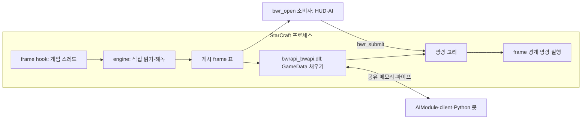

# BWRAPI 구조와 변경 규칙

게임 안 DLL이 게임 스레드의 frame 경계에서 게임 상태를 한 번 읽어 표로 게시하고, 명령을 같은 경계에서 실행한다. BWAPI 4.4 규칙은 그 표로 GameData를 채우는 게임 안 server 한 곳에 있고, 나머지 소비자는 표나 GameData를 읽기만 한다.

공개 API 사용은 [SDK.md](SDK.md)와 [C-ABI.md](C-ABI.md), BWAPI와의 차이는 [BWAPI-COMPATIBILITY.md](BWAPI-COMPATIBILITY.md), SCR 원천의 현재 계약은 [현재 상태](memory/current-state.md), 값별 의미·한계는 [주소 장부](memory/memory-addresses.json)에 있다. `Layout`의 x64·x86 주소와 구조체 배치는 `python tools/memory-map/layout-map.py`가 HTML 한 장으로 나란히 그린다([안내](../tools/memory-map/README.md)).

## 1. 구성과 소유

| 구성 | 소유하는 것 |
|---|---|
| `crates/layout` | SCR 레코드 크기·필드 오프셋·모듈 RVA·판 식별(`Layout::{X64,X86}`)의 유일한 원천 |
| `crates/memory`, `crates/engine` | 프로세스 메모리 읽기(게임 안 직접 읽기·ReadProcessMemory), 해독, source별 열 표, 명령 인코딩 |
| `crates/game`, `crates/ffi` | `bwrapi.dll`: 게임 안 frame hook·게시·명령 실행(`game`)과 공개 C ABI 1.0·헤더/바인딩 생성(`ffi`) |
| `host/` | 게임 안 BWAPI 4.4 server `bwrapi_bwapi.dll`(표 → GameData, 공유 메모리·파이프, draw shape → `bwr_draw`), x86 loader |
| `python/bwrapi/` | BWAPI 4.4 client(`bwapi`), ABI 1.0 바인딩(`native`), launcher |
| `dotnet/` | ABI 1.0 .NET 바인딩 `BwrApi.Client` |

## 2. 읽기와 frame

- **주입**: 게임 안 DLL은 실행 중인 게임에 창 hook으로 들어간다(`bwr_inject`). hook DLL은 비트 수가 같은 프로세스에만 들어가고, 그 DLL을 읽어 hook을 거는 프로세스도 비트 수가 같아야 한다. 그래서 x64·x86 배포물은 비트 수별 폴더에 `bwrapi.dll`·server와 같은 비트 수의 `bwrapi-inject.exe`를 두고, `bwr_inject`는 게임의 비트 수(`IsWow64Process`)가 자기와 다르면 넣을 DLL 옆의 `bwrapi-inject.exe`에 같은 인자를 넘겨 그 프로세스가 hook을 걸게 한다. launcher는 게임의 비트 수로 넣을 server 폴더를 고른다.
- **frame hook**: 게임 안 감시 스레드가 frame 번호가 바뀌면 게임 창에 메시지를 보내고, 창 procedure가 게임 스레드에서 frame 콜백을 실행한다. 콜백이 도는 동안 게임은 기다린다. SC:R x64의 코드 영역은 보호 변경과 쓰기가 막힌 매핑이라 공식 BWAPI처럼 코드에 점프를 넣을 수 없다. 그래서 게임이 쓰기 가능한 메모리에 들고 있는 함수 포인터 칸은 hook 표(`crates/game`의 `slots`)가 설치 직후와 매 frame 경계에 맞춘다 — 칸이 내 함수가 아니면 그 값을 원래 함수로 저장하고 교체하고, 칸을 못 찾으면 건너뛴다. 그래서 경기 전·중 어느 때 붙어도, 게임이 객체를 새로 만들어도 같은 동작이 흡수된다. 표의 항목은 둘이다.
  - 채팅 대화상자의 사건 처리 칸: 채팅 capture가 켜져 있으면 Enter 줄을 받아 상자를 Escape처럼 닫아 게임이 보내지 않게 한다.
  - renderer 객체의 vtable 포인터 칸: DLL 안 사본 vtable(원래 vtable에서 한 번 복사하고, 원래 vtable이 바뀌면 다시 만든다)을 넣는다. 사본의 `render`는 `bwr_draw`로 받은 마지막 도형 목록을 게임의 그리기 queue에 게임 자신의 그리기 코드와 같은 형식(vertex·index buffer 끝에 덧붙인 삼각형, 정렬 layer 하나의 명령)으로 덧붙이고 원래 `render`를 부른다. 글자는 게임의 glyph cache와 atlas texture를 그대로 쓴다. 그래서 도형은 게임 화면 안(게임 화면·콘솔 위, cursor 아래)에 그려지고, 표시 frame마다 다음 목록이 올 때까지 다시 그려진다.
- **받은 채팅**: 같은 경계에서 게임의 리플레이 기록 버퍼를 걷는 파서(`crates/engine`의 `recorder`)에서 온다 — 받은 줄(채팅 명령의 보낸 플레이어 번호와 글)은 chat 큐로. 리플레이 재생 중에는 기록이 꺼지고 버퍼가 리플레이 전체를 담으므로, 게임 frame까지 실행된 기록의 끝을 쓰인 끝으로 본다.
- **수리·환불 합계**: 게임이 플레이어 광물·가스를 바꾸는 명령 중 BWAPI가 세는 것(`Layout`의 `resource_writes`)에서 온다. 경기 동안 그 배열이 든 heap 페이지를 읽기 전용으로 두면 쓰기마다 vectored 예외 처리기(`crates/game`의 `resources`)가 불리고, 처리기는 페이지를 잠시 쓰기 가능으로 돌리고 그 명령 하나를 DLL이 마련한 실행 메모리에 옮겨 실행하게 한다(`instruction`). 옮긴 명령 뒤에서 DLL로 돌아와 페이지를 다시 막고, 세는 명령이면 바뀐 양을 그 플레이어 합계에 더한 뒤 원래 명령 다음으로 이어 간다. single step은 쓰지 않는다(x86 판 네트워크 게임은 게임 스레드에 single step 예외가 나면 멈춘다). 합계는 players 표의 열로 나간다.
- **turn 시각**: 감시 스레드는 같은 주기로 turn 보낸 수를 읽어 바뀌면 그 시각(QPC)을 기록하고(frame을 읽는 쪽도 읽기 직전에 한 번 더 본다), 게시 게임 표가 그 시각을 실고 나간다.
- 콜백에서 엔진이 구독한 source만 읽어 열 단위 표를 게시한다. 같은 표를 게임 안 server(`bwr_open_self`)와 다른 프로세스(`bwr_open(pid)`)가 읽는다. 게임 안 DLL이 없는 게임은 `bwr_open(pid)`가 그 프로세스에서 ReadProcessMemory로 읽고, frame 번호로 찢어짐을 확인한다. 어느 쪽이든 표는 같다.
- 유닛 id는 `(slot+1) | uniqueness<<16`(0은 없음)로 기록 없이 계산하므로, 같은 게임을 읽는 모든 세션이 같은 id를 쓴다.
- 메뉴·로딩·일시정지·경기 끝은 정상 상태다. 일시정지 중에도 게시 frame이 바뀔 수 있으며 이것이 게임 진행의 증거는 아니다.

## 3. 값 규칙

- 모르는 값은 형의 sentinel(부호 없음 최댓값, 부호 있음 최솟값, 빈 문자열)이다. 알려진 0·false·빈 목록과 구분하며, 추정값으로 채우지 않는다.
- ABI 직접 읽기는 모르는 값을 그대로 sentinel(Python은 바인딩 그대로)로, BWAPI 봇 경로(server·Python client)는 BWAPI 기본값으로 돌려준다.
- SCR 오프셋·레코드 크기는 `Layout`에만 둔다. host·SDK·.NET은 엔진 표와 생성된 상수를 쓴다. host·Python에서 SCR raw 레코드를 해석하지 않는다.

## 4. 명령

- 쓰기의 범위는 게임 명령과 게임 설정 명령이다. HP·자원·위치 같은 임의 상태 수정과 임의 메모리 쓰기는 없다.
- `bwr_submit`은 명령을 게임의 명령 고리(`Local\bwrapi_game_commands_<pid>`)에 넣고 바로 돌아온다. 게임 안 DLL이 다음 frame 경계(frame 콜백 안에서 넣었으면 바로 그 경계)에서 게임 함수로 실행하고, 결과는 `bwr_poll_result`로 나중에 읽는다. 게임 안 DLL이 없으면 명령은 `BWR_NO_COMMANDS`다.
- 결과 `OK`는 게임 함수를 불렀다는 뜻이다. 게임 효과는 이후 frame의 값으로 확인한다.
- BWAPI server는 GameData의 unit·game command를 같은 경로로 제출한다. 결과는 봇에 돌려주지 않고 로그에 남긴다.

## 5. BWAPI 4.4 경로

- server는 frame 콜백에서 acquire → GameData 채우기 → client에 ready → update 대기 → 명령 submit → release를 한다(동기). 비동기 연결은 ready를 보낸 뒤 기다리지 않고, client update가 들어온 뒤 첫 frame에 그 명령을 실행한다.
- projection은 엔진 표가 slot 순서라 frame마다 배열을 한 번 훑어 채운다. 유닛 사건은 frame별 유닛 집합의 차이로 공식 GameUnits 순서대로 만든다.
- BWAPI 4.4 업스트림은 `host/CMakeLists.txt`의 고정 커밋을 받는다. x86 loader는 업스트림 AIModuleLoader·BWAPIClient를 빌드 때 복사해 최소한만 고친다(`host/cmake/*.cmake`).

## 6. 변경 규칙

작업 규칙(계약과 소비자를 같은 변경에서 갱신, 새 오프셋은 `Layout`, 검사·분기 최소화, 문서에는 현재 상태만)은 저장소 루트 [AGENTS.md](../AGENTS.md)에 있다. 여기에는 구조에 관한 것만 둔다.

- ABI 1.0 헤더·C#·Python 선언은 Rust 정의에서 `bwrapi-gen`(`cargo xtask build`)이 생성한다.
- 검증 기대값은 구현을 따라 쓴 값이 아니라 게임 원문·공식 BWAPI 동작·독립 fixture에서 정한다.

## 7. 현재 한계

- x86 게임: 명령 실행기(x86 호출 규약: cdecl, 채팅 전송은 thiscall)·그리기·수리·환급 집계·게임 속도가 `Layout::X86` 값으로 x64와 같은 코드 경로를 쓰고, 빌드가 x86 `bwrapi.dll`·server를 함께 만든다.
- BWAPI 4.4와의 차이는 [BWAPI-COMPATIBILITY.md](BWAPI-COMPATIBILITY.md)에 있다.
- 부하·timeout·crash 때 명령의 실행 여부는 보장하지 않는다. 결과를 읽지 못한 명령을 자동으로 다시 보내지 않는다.
